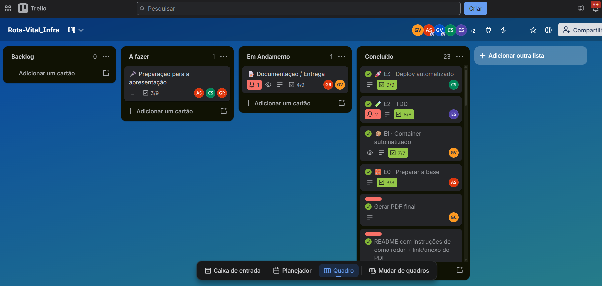

# 🏥 Rota Vital

API em Java 21 + Spring Boot que gera requisições de atendimento hospitalar, calcula
estatísticas por hospital de forma sequencial ou paralela (com N threads) e guarda o histórico
das execuções no PostgreSQL. Roda em container e é publicada automaticamente pela esteira de CI/CD.

🔗 **API pública:** <https://rota-vital-api.onrender.com>

## 🚀 Como executar

**Com Docker** (recomendado, sobe API + PostgreSQL):

```bash
cp .env.example .env
docker compose up -d --build
curl "localhost:8080/estatisticas/paralelo?tamanho=100000&threads=4"
```

**Sem Docker:** suba um PostgreSQL em `localhost:5432` e rode `./mvnw spring-boot:run`
(`mvnw.cmd` no Windows). Passo a passo na seção 2 do [CONTRIBUTING](./CONTRIBUTING.md#2-rodando-localmente).

| Documento | Conteúdo |
| --- | --- |
| [docs/docker.md](./docs/docker.md) | comandos, variáveis do `.env` e decisões do container |
| [docs/api.md](./docs/api.md) | endpoints, formato da resposta, erros e limites de recursos |
| [docs/deploy.md](./docs/deploy.md) | pipeline CI/CD, segredos, rollback e evidências da E3 |
| [docs/pi-tdd.md](./docs/pi-tdd.md) | histórias H1–H3, tarefas e relato do TDD |

## 🧪 Testes

```bash
./mvnw test                                       # suíte completa (H2 em memória, sem PostgreSQL)
./mvnw -B -Dtest=ValidadorParametrosTest test     # uma classe só
```

Há testes unitários (regras e validação), de integração (repositório com H2) e de aceitação
(endpoints HTTP, histórico e limites). A mesma suíte roda no [GitHub Actions](./.github/workflows/ci.yml)
e, se falhar, barra a imagem e o deploy.

## 🗂️ Estrutura

```
src/main/java/io/github/_ndrewss/rota_vital/
├── controller/   # EstatisticaController, HistoricoController, ApiExceptionHandler
├── model/        # Requisicao, EstatisticaHospital, ExecucaoHistorico
├── repository/   # ExecucaoHistoricoRepository
├── security/     # LimiteRequisicoesFilter (taxa e concorrência)
├── service/      # EstatisticaService (sequencial/paralelo), HistoricoService
└── util/         # GeradorRequisicoes, ValidadorParametros
src/test/java/...  # mesmos pacotes: *Test (unitário), *IntegracaoTest, *AceitacaoTest e *HttpTest
```

## 🗺️ Story map do PI

Da esquerda para a direita, o fluxo de uso; de cima para baixo, a prioridade.

| | Gerar massa de dados | Processar | Comparar desempenho | Histórico |
| --- | --- | --- | --- | --- |
| **Antes do PI** | gerar N requisições | sequencial e paralelo | tempo gasto em ms | entidade e repositório, sem uso |
| **Release 1 (este PI)** | — | **H1** validar `tamanho` e `threads` | — | **H2** registrar execução · **H3** consultar histórico |
| **Release 2 (ideias)** | semente fixa | limites por perfil de uso | comparação entre execuções | filtrar histórico por tipo |

## 📁 Evidências

| Etapa | Onde |
| --- | --- |
| **E1 — Container** | [compose ps](./docs/evidencias/e1-compose-ps.png) · [healthcheck](./docs/evidencias/e1-api-health.png) · [requisição](./docs/evidencias/e1-api-sequencial.png) |
| **E2 — TDD e testes** | [docs/pi-tdd.md](./docs/pi-tdd.md) · [testes](./src/test/java/) · [Actions](https://github.com/4ndrewss/Rota-Vital_Threads2/actions) |
| **E3 — Deploy** | [docs/deploy.md](./docs/deploy.md#evidências) |

## 🧭 Decisões

| Decisão | Escolha | Por quê |
| --- | --- | --- |
| Imagem | `eclipse-temurin:21` multi-stage (JDK no build, JRE alpine na execução) + `postgres:16-alpine` | imagem final ~390 MB (vs ~950 MB), sem JDK/código-fonte, usuário não-root |
| Dados | PostgreSQL em volume nomeado (Compose) e gerenciado (Render) | histórico sobrevive a reinícios e rebuilds |
| Testes | JUnit 5 + MockMvc + H2 | suíte roda em segundos no build e no CI, sem banco externo |
| Branches | GitHub Flow (`main` protegida + PRs) | simples, com revisão e check verde antes do merge |
| CI/CD | GitHub Actions (testes → GHCR → deploy) + Render | integrado ao repo, imagens por SHA, deploy só com esteira verde |
| Segredos | `.env` fora do Git + GitHub Secrets + variáveis do Render | nenhuma senha ou hook no repositório ou na imagem |

## 🤖 Uso de IA

Declaração exigida pelo [CONTRIBUTING](./CONTRIBUTING.md#9-uso-de-ia); tudo foi revisado pelo grupo.

- **Claude (Claude Code):** testes, código, workflow de CI e documentação inicial do PI. Prompt e
  limites em [docs/pi-tdd.md](./docs/pi-tdd.md#uso-de-ia). Também enxugou este README e separou os
  detalhes em `docs/` (prompt: *"enxugar a documentação o máximo possível e remover o que era da entrega de Threads 2"*).
- **CodeRabbit Coding Agent:** limites de recursos, paginação, Javadoc e as correções de concorrência
  e deploy por commit (*"separar as execuções manuais e enviar o commit exato pelo parâmetro ref"*).
- **Gemini (Antigravity):** pipeline CI/CD e documentação de decisões e rollback (*"Estruturar o
  pipeline completo de CI/CD no GitHub Actions (build e testes -> imagem Docker no GHCR com tags
  latest e SHA -> deploy via Deploy Hook no Render com segredos no GitHub Secrets) e documentar
  decisões e rollback no README"*).

## 👥 Integrantes

| Integrante | GitHub |
|---|---|
| Andrews Queiroz | [@4ndrewss](https://github.com/4ndrewss) |
| Caio Gilles | [@CaioGilles](https://github.com/CaioGilles) |
| Enzo Amorim | [@ENZOBRS](https://github.com/ENZOBRS) |
| Gabriela Bayo | [@gabibayo](https://github.com/gabibayo) |
| Glauco Santos | [@glaucosantos002](https://github.com/glaucosantos002) |
| Gustavo Veloso | [@velosogustavo](https://github.com/velosogustavo) |

📋 Gestão no [Trello da equipe](https://trello.com/b/nTGVCC8F/rota-vitalinfra). Fluxo de branches
e commits no [CONTRIBUTING](./CONTRIBUTING.md). Convenções: tempos em milissegundos, código e
comentários em português, indentação com tab.


